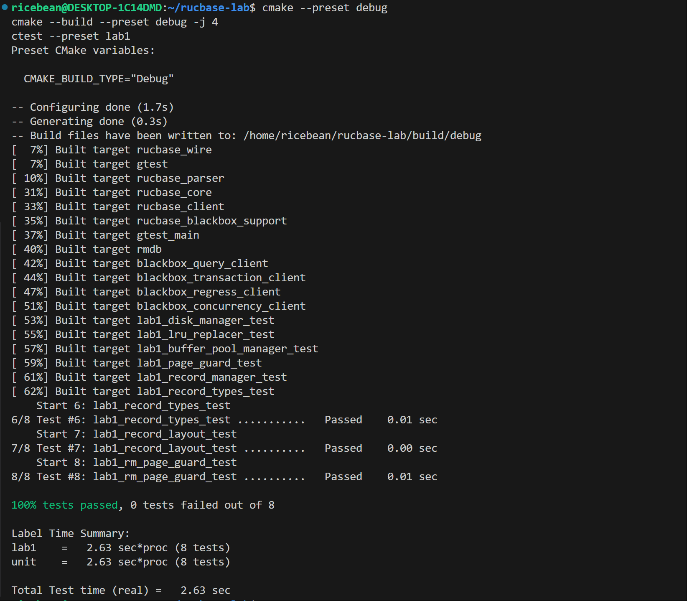

# RUCBase Lab1 存储管理实验报告

孙安江
2024201504

## 实验结果及分析

### 1. 磁盘管理器

磁盘管理器维护文件路径与文件描述符之间的双向映射。创建文件时使用排他创建，避免同名文件被覆盖；打开、关闭和删除操作都会先检查当前状态，并在系统调用失败或参数状态不合法时抛出对应异常。由于创建文件与打开文件含义不同，创建完成后不会把文件加入打开映射，只有 `open_file()` 成功后才会同时更新两张映射表。

页面读写根据页号计算字节偏移，再执行指定长度的 I/O。实现中没有假设一次系统调用一定完成全部数据，而是检查实际读写字节数；不完整时按内部错误处理。测试覆盖了 32 个文件的创建、打开、关闭和删除，以及 128 个页面的随机数据写入与读回。

### 2. LRU 替换器

替换器用双向链表记录可淘汰帧，用哈希表记录帧号到链表节点的映射。链表头部是最久未被访问的帧，尾部是最近进入可淘汰集合的帧，因此取 victim 时删除头部即可，`pin()` 和 `unpin()` 也可以通过哈希表常数时间定位节点。所有操作均使用互斥锁保护。

调试时发现，对已经处于可淘汰集合中的帧再次调用 `unpin()` 不能改变原有顺序；帧被 `pin()` 移出集合后，再次 `unpin()` 才重新放到尾部。实现最终按这一语义处理，并通过了顺序、随机操作和多线程测试。

### 3. 缓冲池管理器

缓冲池使用页表、空闲帧链表和固定计数管理内存页面。申请页面时优先从空闲链表取帧，没有空闲帧时再通过 LRU 替换器选择 victim。若 victim 是脏页，需要先把旧页面写回磁盘，再清除页面内容、更新页号和页表。页命中时只增加固定计数，并把该帧从替换器移出。

`unpin_page()` 只减少一次固定计数，计数归零后才允许替换器管理该帧。`flush_page()` 不要求页面未被固定，会强制写回并清除脏位；`delete_page()` 在页面仍被固定时拒绝删除。当前实现采用缓冲池级别的粗粒度互斥锁，使页表、空闲链表、pin count 和 LRU 状态始终一致。

该部分测试包含小规模基础操作、10000 页读写、32 文件混合访问和 5 线程并发场景。测试中重点检查了脏页淘汰后的数据是否正确、固定页是否会被错误回收，以及删除后是否出现遗留 pin。

### 4. 记录管理器

记录文件第 0 页保存文件头，后续页面由页头、bitmap 和定长记录槽组成。新建数据页时初始化页头和 bitmap，并将页号加入空闲页链；页面插入到满后从空闲链中移除，删除使页面重新出现空闲槽时再放回链头。每次修改 bitmap 都同步维护页面的记录数。

记录读取、更新和删除使用页 guard 管理页面固定与释放，异常返回时也不会遗留 pin。插入操作直接使用页号、槽号顺序查找空位，并把新记录放在第一个清零的 bitmap 位。扫描器从第 1 页开始逐页、逐槽查找 bitmap 中为 1 的位置，遇到空槽或空页时继续向后移动。记录测试执行了 1000 轮随机插入、更新、删除和重新打开文件，并额外测试了 32 个记录文件。

## 测试结果

## 可能存在的性能瓶颈

1. 缓冲池目前对整个页表和帧状态使用一把互斥锁。虽然实现简单且容易保证一致性，但多个线程命中不同页面时也会发生等待，高并发下吞吐量受限。
2. 页面淘汰和批量刷新期间持有缓冲池锁并执行磁盘 I/O，I/O 延迟会阻塞其他线程访问缓冲池。后续可以考虑缩小锁粒度，或把锁外 I/O 与页面状态提交分开处理。
3. 每次装入页面都会清零整个 4 KiB 页面，在大规模随机访问时带来额外内存写入；该代价换来了页面元数据和旧数据不会被误用的确定性。
4. LRU 的插入、删除和选择 victim 均为常数时间，主要开销集中在互斥锁竞争和哈希表访问；记录扫描的开销则主要来自逐页固定、复制记录以及 bitmap 位检查。

## 实验总结

本次实验完成了磁盘访问、LRU、缓冲池和定长记录管理。通过处理脏页回写、pin 计数和空闲页链，我更清楚地理解了各层状态必须保持一致；当前粗粒度锁保证了正确性，但并发性能仍有改进空间。
