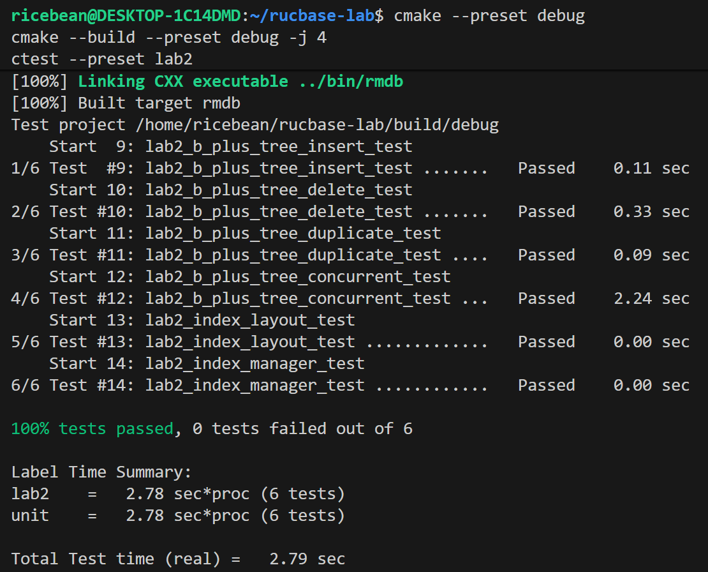

# RUCBase Lab2 索引管理实验报告

孙安江  
2024201504

## 实验结果及分析

### 1. 页内查找与有序插入

`BPlusTreeNode` 中的键和 `Rid` 分别连续存放，因此节点内的 `lower_bound()` 与 `upper_bound()` 都采用二分查找，比较时使用项目提供的复合键比较函数，以兼容整数、浮点数和字符串索引。叶子节点的 `leaf_lookup()` 先定位第一个大于等于目标键的位置，再判断键是否真正相等。内部节点通过 `upper_bound()` 定位目标键右侧的子树；当目标键小于节点最小键时，会进入最左侧孩子。

插入操作使用 `upper_bound()` 得到插入位置，使新记录位于相同键的已有记录之后。`insert_pairs()` 先移动原有键和 `Rid` 数组，再复制新数据，同时检查位置、空指针和容量，避免越界写入。

### 2. 查找与重复键扫描

树的定位从根节点开始逐层下降到叶子。普通索引允许重复键，同一条键的记录可能因节点分裂而跨越多个相邻叶子，因此 `get_value()` 没有把第一次到达的叶子当作完整答案。它先沿前驱叶子向左回溯，直到前一叶子的最大键小于目标键，再沿后继叶子向右扫描，直到遇到更大的键。

`lower_bound()` 和 `upper_bound()` 沿用相同的跨叶思路，并统一处理“位置位于非最后叶子的末尾”这一情况：此时返回下一叶子的第 0 个槽，保证其表示方式与 `IndexScan::next()` 到达的位置一致。一次查找的时间复杂度为树高和对数比较开销，重复键较多时还要额外访问包含该键的叶子。

### 3. 插入与节点分裂

插入先定位叶子，再在原叶子中按顺序写入。当节点大小达到容量上限后，`split()` 将原节点划分为左右两部分，右半部分移入新页。叶节点分裂时同步修改前后两个叶子链接，并处理最后一页标记；内部节点分裂时逐个修正被移动孩子的父页号。

`insert_into_parent()` 在父节点中替换原孩子的首键，并插入新节点的首键。如果父节点也达到容量上限，就继续分裂并向更高层传播；原根分裂时会创建一个新的内部根。实现保持“内部节点中每个键等于对应孩子子树的最小键”这一不变式，因此子树的边界变化会沿祖先链更新。

### 4. 删除与再平衡

`delete_entry()` 只删除键和 `Rid` 同时匹配的一项。由于相同键可能被分到多个叶子，删除也会在相邻叶子中继续寻找目标记录；未找到对应 `Rid` 时返回 `false`，不会误删同键的其他记录。

叶子或内部节点低于最小占用后，`coalesce_or_redistribute()` 优先选择前驱兄弟，没有前驱时选择后继兄弟。若两个节点能够维持最小占用，则从兄弟移动一个键值对并更新父节点的边界；否则将右节点合并到左节点，更新叶链、父指针和页面计数，再递归检查父节点。根节点只剩一个孩子时会收缩；最后一个叶子被清空时则恢复为空树状态。

调试删除测试时曾出现“根节点的首键不等于左孩子子树最小键”的失败。问题发生在最左孩子与后继兄弟合并时：父节点删除了右孩子，却仍保留合并前的首键；如果父节点恰好是根，代码也不会继续进入普通的祖先更新分支。修复后，合并在父节点再平衡之前先同步保留子树的首键，左侧重分配改变父节点最小值时也会继续向更高层传播。修复后小规模删除和两万次随机插入、删除测试均通过。

### 5. 唯一索引

普通索引允许多条相同键，唯一索引只允许一条。`insert_entry()` 在修改树之前检查 `is_unique()`；如果已经存在相同键，直接抛出 `DuplicateKeyError`。由于检查发生在创建页面、分裂和更新祖先之前，失败时不会留下部分插入结果。这里的唯一性判断针对索引键，不针对键与 `Rid` 组成的整体条目，因此即使新条目使用另一个 `Rid`，只要键相同也会被拒绝。

### 6. 并发控制

本实验采用指导书中允许的粗粒度方案，用 `root_latch_` 保护整棵树的查找、插入和删除。主要公开检索和写入口加锁，内部辅助函数假定调用者已经持锁，从而避免同一次操作的递归路径重复加锁。这个方案让写操作与遍历、祖先键更新互斥，优先保证结构一致性和正确性。

50 线程测试首次运行时，在 1 GiB 地址空间限制下创建线程失败，程序在测试框架构造线程组时终止。将线程栈限制调整为每线程 2 MiB，并给测试进程保留 2 GiB 地址空间后，相同代码的并发插入以及并发删除测试均通过，这说明终止原因来自测试资源限制，而不是 B+ 树操作本身。

## 测试结果

## 可能存在的性能瓶颈

1. 当前整棵树共用一把互斥锁，查找之间不能并行，树较大或读多写少时吞吐量会受限。
2. 重复键跨多个叶子时，查找和删除要沿叶链逐页检查，若某一键的选择度很低，则会扫描大量重复项。
3. 节点分裂和合并期间会同时固定多个页面、产生页面读写，若缓冲池命中率低，则磁盘 I/O 会明显增大延迟。
4. 当前没有复用已删除的逻辑页面，索引文件在频繁分裂和合并后可能保留较多空洞。

## 实验总结

本次实验中，我完成了 B+ 树的节点操作、树级查找、插入、删除、重复键和唯一约束，用整树互斥锁支持并发操作。

通过本次实验，我加深了对B+树索引结构的理解，并重点认识到页内结构、父指针、叶链和祖先最小键必须同时保持一致。
